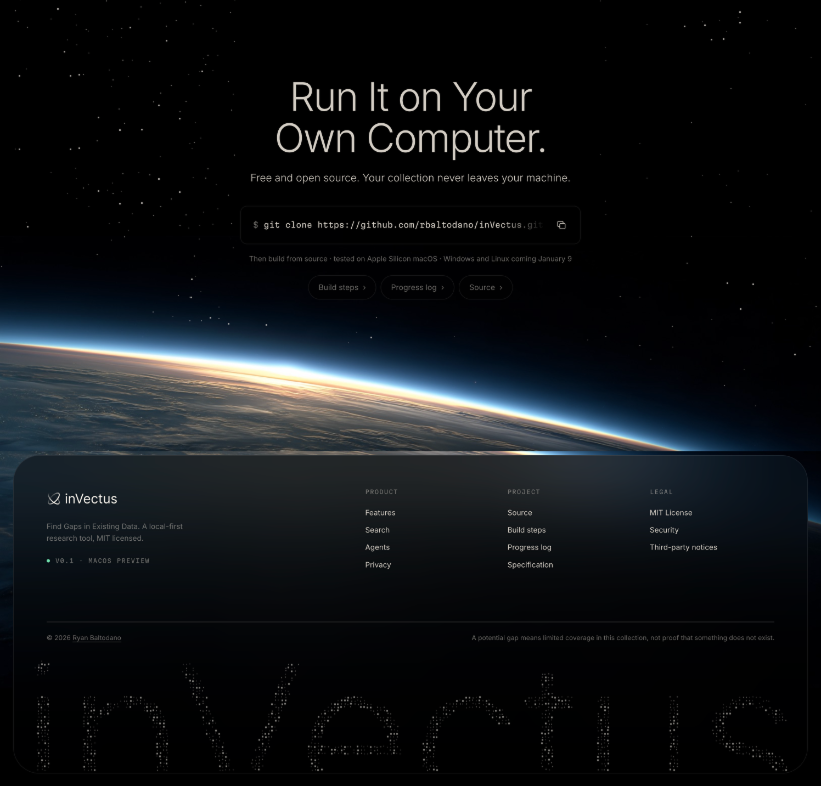

# Hey, I'm Ryan

I'm a design engineer. I design software, write the code that ships it, and I'm the one who gets annoyed when a corner radius is off by two pixels. Right now that's two apps I built on my own: **[Angrove](#angrove)** and **[inVectus](#invectus)**.

[Résumé (PDF)](https://ryanbaltodano.com/assets/Ryan-Baltodano-Resume.pdf) · [ryanbaltodano.com](https://ryanbaltodano.com) · [Try Angrove on TestFlight](https://testflight.apple.com/join/qHDFeAUa) · [Install inVectus](https://invectus.app)

## Angrove

Angrove is the one I'm proudest of. People see a chat box and assume it's another AI study app. It isn't. It's a harness that happens to ship with a language model built in. Think Claude Code, but for education.

Ask it about philosophy, theology, or history and it answers from a library of primary sources, cites them, and tells you when a source is missing instead of making up a quote. The ideas you save get mapped by meaning, so you can see how they connect. The model, the search, and your notes all stay on your device. No server, no account.

- On-device Gemma 4 E4B through LiteRT-LM, with Core ML embeddings over 51,836 passages from 37 works
- SwiftUI on iPhone and Mac from one codebase, designed in Figma first
- AES-256-GCM encrypted storage, with the keys in the Keychain
- iPhone public beta on TestFlight now; the Mac app is in progress

 

  
  
  
  

[Read the case study](https://angrove.app/case-study.html) · [Watch the 1:49 demo](https://angrove.app/case-study.html#demo-conversation) · [All screenshots and recordings](https://github.com/rbaltodano/Angrove-iOS/blob/main/Documentation/Screenshots/2026-10-22/README.md)

## inVectus

Most search finds what's already in your data. inVectus finds what isn't. It started when my brother was picking a medical school research topic, and the hard part was finding something nobody had done yet. So inVectus embeds a collection, looks for the empty spots on the map, and turns them into plain-language descriptions.

It's a desktop app with React and TypeScript up front, a Rust engine underneath, and everything running on your own computer. If for some reason you'd rather not look at my UI, connect your favorite agent over MCP and let it do the work. One honest caveat: a gap is a candidate worth reviewing in that collection, not a validated discovery.

v0.1.0 is out for Apple Silicon Macs with a one-line installer, and Windows and Linux are in beta testing. It's MIT licensed, so feel free to steal anything useful (contributions welcome too).

[Install from invectus.app](https://invectus.app) · [Repository](https://github.com/rbaltodano/inVectus) · [Reproducible demo](https://github.com/rbaltodano/inVectus/blob/main/docs/demo.md) · [Architecture and tradeoffs](https://github.com/rbaltodano/inVectus/blob/main/docs/architecture.md)

I also designed and built [invectus.app](https://invectus.app). Scroll to the bottom. The stars are papers, and you can click them.

## Repositories

| Repository | What it is |
| --- | --- |
| [inVectus](https://github.com/rbaltodano/inVectus) | Desktop research workspace and CLI: Rust, Tauri, React/TypeScript, local embeddings, and collection analysis |
| [invectus-website](https://github.com/rbaltodano/invectus-website) | inVectus product website: visual design, responsive HTML/CSS, and interactive collection map |
| [Angrove-iOS](https://github.com/rbaltodano/Angrove-iOS) | The iPhone and Mac apps: on-device runtime, retrieval, encrypted persistence, and the Insight Tree |
| [Angrove-Foundations](https://github.com/rbaltodano/Angrove-Foundations) | Product, design, and model-integration documentation, plus case studies |
| [Angrove-Backend](https://github.com/rbaltodano/Angrove-Backend) | Offline Python tooling: corpus preparation, model conversion, and evaluation |
| [angrove-website](https://github.com/rbaltodano/angrove-website) | Angrove's product site, User Guide, demos, case studies, and development notes |
| [ryanbaltodano.com](https://github.com/rbaltodano/ryanbaltodano.com) | Personal portfolio website: static HTML, CSS, and JavaScript |

## What I work with

- **Design:** Figma, design systems, interaction design, and the details between screens
- **Apple platforms:** Swift, SwiftUI, Swift Testing, TestFlight
- **Desktop and web:** Rust, Tauri, React, TypeScript, HTML, CSS
- **AI:** on-device models (LiteRT-LM, Core ML, ONNX Runtime), embeddings, retrieval, evaluation
- **Data and tooling:** DuckDB, LanceDB, SQLite, Python, GitHub Actions

Still learning Rust. I like it: the code is fast, even if the compiler very much isn't.

Tampa, FL. Looking for design engineer roles on AI products, iOS included, and happy to relocate. Or just say hi and talk shop: [rbaltodano337@gmail.com](mailto:rbaltodano337@gmail.com)
